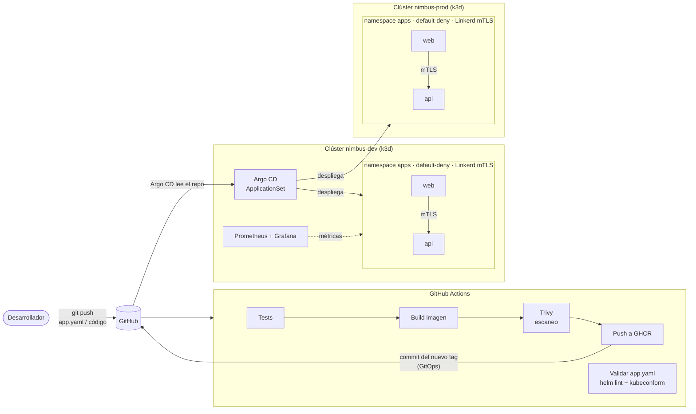

# Nimbus ☁️

**Una mini plataforma interna de despliegue (PaaS) sobre Kubernetes.**
Un desarrollador describe su aplicación en un `app.yaml` de pocas líneas y la plataforma se encarga del resto: construir, desplegar en varios clústeres, aislar en red con un modelo *zero trust*, cifrar el tráfico con mTLS y monitorizar.

```yaml
# apps/web/app.yaml — todo lo que escribe el desarrollador
name: web
image:
  repository: ghcr.io/davidmesamoyano/nimbus-demo-app
port: 8080
talksTo: [api]       # solo puede hablar con api; lo demás está bloqueado
expose:
  enabled: true
```

`git push` → la app queda desplegada en **dev**, protegida y monitorizada. Una Pull Request la promociona a **prod**.

---

## Por qué existe

Kubernetes es muy potente, pero exige a los equipos de desarrollo dominar Deployments, Services, Ingress, NetworkPolicies, probes, límites de recursos, observabilidad… Esa complejidad suele crear fricción entre desarrollo y operaciones.

Nimbus aplica la idea de **Platform Engineering**: el equipo de plataforma define una vez cómo se despliega bien una app (seguridad, recursos, métricas) y los desarrolladores solo declaran *qué* quieren, no *cómo*.

## Arquitectura



| Pieza | Herramienta | Qué aporta |
|---|---|---|
| Contrato del desarrollador | `app.yaml` + **JSON Schema** | Formato simple, validado antes de llegar al clúster |
| Plantilla de la plataforma | **Helm** (chart `nimbus-app`) | Traduce el `app.yaml` a Deployment, Service, Ingress, NetworkPolicy, ServiceMonitor y PDB con buenas prácticas incluidas |
| Despliegue continuo | **Argo CD** (ApplicationSet) | GitOps: Git es la única fuente de verdad; añade cada app a cada clúster automáticamente |
| Multi-cluster | **k3d** (dev y prod) | Dos entornos gestionados desde un único plano de control |
| Integración continua | **GitHub Actions** + **Trivy** + **GHCR** | Tests, imagen, escaneo de vulnerabilidades y publicación |
| Zero trust | **NetworkPolicies** (default-deny) | Solo se permite el tráfico declarado en `talksTo` |
| Cifrado entre servicios | **Linkerd** | mTLS automático sin tocar el código de las apps |
| Observabilidad | **Prometheus** + **Grafana** | Tráfico, errores, latencia p95 y réplicas de cada app |

## Cómo funciona

**1. Un `app.yaml` por app.** Vive en `apps/<nombre>/app.yaml`. El esquema [`values.schema.json`](platform/charts/nimbus-app/values.schema.json) define qué campos se aceptan: si alguien escribe `replicas: 50` o un campo inventado, Helm lo rechaza.

**2. Un chart genérico para todas.** [`platform/charts/nimbus-app`](platform/charts/nimbus-app) añade lo que el desarrollador no tiene que saber: contenedor sin root y con sistema de ficheros de solo lectura, *probes*, recursos por tallas (`small`/`medium`/`large`), PodDisruptionBudget cuando hay varias réplicas y una variable `NIMBUS_<APP>_URL` por cada servicio de `talksTo`.

**3. GitOps multi-cluster.** Un [ApplicationSet](platform/argocd/applicationsets.yaml) cruza los clústeres registrados (etiquetados `dev` / `prod`) con las carpetas de `apps/`. Crear una carpeta nueva y hacer push basta para desplegar una app en ambos entornos. Cada entorno puede ajustar réplicas, talla o versión en `environments:`.

**4. Zero trust por defecto.** El namespace `apps` deniega **todo** el tráfico. La NetworkPolicy de cada app abre únicamente:
- entrada desde las apps que la declaran en su `talksTo` (mediante la etiqueta `nimbus.io/to-<app>`),
- entrada desde el Ingress si `expose.enabled`, desde Prometheus y desde Linkerd,
- salida a DNS, a Linkerd y a las apps de su `talksTo`.

Además, Linkerd inyecta un proxy en cada pod y cifra con **mTLS** toda la comunicación entre apps.

**5. Flujo de versiones.**
- Push a `demo-app/` → CI testea, construye, escanea y publica la imagen → hace commit del nuevo tag en el bloque `dev` de los `app.yaml` → Argo CD actualiza **dev**.
- `./scripts/promover.sh` copia el tag de dev a prod → Pull Request → merge → Argo CD actualiza **prod**.

## Pruébalo

Requisitos (todos gratuitos): Docker Desktop (6 GB de RAM recomendados), k3d, kubectl, Helm y Git. En Windows, los scripts se ejecutan desde **Git Bash**.

```bash
./scripts/00-comprobar-requisitos.sh
./scripts/01-crear-clusters.sh       # nimbus-dev y nimbus-prod
./scripts/02-instalar-plataforma.sh  # Linkerd, Prometheus/Grafana, Argo CD
./scripts/03-imagen-local.sh         # imagen de ejemplo (sin esperar al CI)
```

En 2-3 minutos Argo CD habrá desplegado las apps:

| Qué | Dónde |
|---|---|
| App en dev | http://web.localhost:9080 |
| App en prod | http://web.localhost:9090 |
| Argo CD | `./scripts/abrir.sh argocd` → https://localhost:8443 |
| Grafana | `./scripts/abrir.sh grafana` → http://localhost:3000 (panel *Nimbus · Apps*) |

```bash
./scripts/demo-zero-trust.sh   # web→api permitido, intruso bloqueado, tráfico con mTLS
./scripts/trafico.sh           # genera tráfico (con algún error) para ver Grafana en acción
./scripts/destruir.sh          # borra todo
```

### Añadir una app nueva

```bash
mkdir apps/pagos
cat > apps/pagos/app.yaml <<'EOF'
name: pagos
image:
  repository: ghcr.io/davidmesamoyano/nimbus-demo-app
talksTo: [api]
environments:
  dev:  { image: { tag: "local" } }
  prod: { image: { tag: "local" } }
EOF
git add apps/pagos && git commit -m "feat: app pagos" && git push
```

Argo CD crea `pagos-dev` y `pagos-prod` sin tocar nada más.

## Estructura

```
apps/                         catálogo: un app.yaml por aplicación
demo-app/                     microservicio de ejemplo (Python, sin dependencias)
platform/
  charts/nimbus-app/          chart genérico + esquema del app.yaml
  argocd/                     AppProject y ApplicationSets (GitOps multi-cluster)
  namespace/                  namespace apps: Linkerd + default-deny
  monitoring/                 valores de Prometheus/Grafana y panel
scripts/                      crear, instalar, demostrar, promover y destruir
.github/workflows/            CI de la app y validación de la plataforma
```

## Decisiones de diseño

- **Helm + JSON Schema en lugar de un operador propio.** Un operador (CRD + controlador) es la evolución natural, pero un chart con esquema da el 80 % del valor con mucha menos superficie de mantenimiento. Es un buen punto de partida antes de invertir en código.
- **GitOps (pull) en lugar de `kubectl apply` desde el CI (push).** El CI nunca tiene credenciales de los clústeres; Argo CD tira de Git y corrige cualquier cambio manual (*self-heal*).
- **Políticas generadas desde `talksTo`.** El desarrollador declara intención ("hablo con api") y la plataforma escribe las reglas de red. Así la seguridad no depende de que cada equipo sepa escribir NetworkPolicies.
- **k3d para simular multi-cluster.** Mismo modelo que con varios proveedores cloud, pero gratis y reproducible en un portátil.

## Limitaciones y siguientes pasos

- Los secretos no se gestionan todavía (siguiente paso: Sealed Secrets o External Secrets).
- Autoescalado (HPA) y *canary releases* (Argo Rollouts) no incluidos.
- Un operador `kind: App` permitiría validar referencias entre apps dentro del propio clúster.

---

Proyecto de **David Mesa Moyano** · Ingeniero de Telecomunicación · [github.com/davidmesamoyano](https://github.com/davidmesamoyano)
